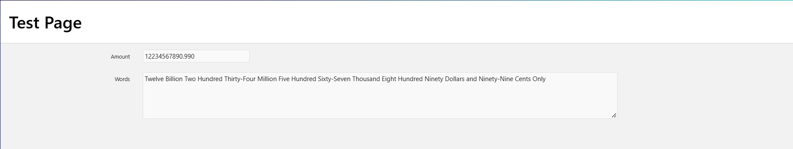
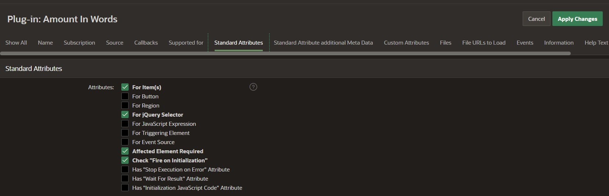

# Amount In Words - Oracle APEX Dynamic Action Plug-in

Converts a number into English words, with the currency's main and sub unit, directly in the browser.

```
1234567.50  (BDT)  ->  Twelve Lakh Thirty-Four Thousand Five Hundred Sixty-Seven Taka and Fifty Paisa Only
1234567.50  (USD)  ->  One Million Two Hundred Thirty-Four Thousand Five Hundred Sixty-Seven Dollars and Fifty Cents Only
```

Useful for bills, invoices, challans, cheques and vouchers, wherever an "amount in words" line is required.

## Features

- Currencies with main and sub unit: **BDT** (Taka / Paisa), **USD** (Dollar / Cent), **EUR** (Euro / Cent), **GBP** (Pound / Penny), **INR** (Rupee / Paisa), plus **Custom** units of your own
- **South Asian** (Lakh, Crore) or **International** (Million, Billion) numbering, chosen automatically by currency or set manually
- Correct singular and plural (`One Dollar`, `Two Dollars`, `One Cent`, `Two Cents`)
- Amount is rounded half up to 2 decimals (`0.995` becomes `One Dollar`)
- Handles negative amounts (`Minus ...`), zero, and formatted input such as `1,234.50` or `Tk 1,250.00`
- Optional suffix text (default `Only`)
- Pure JavaScript in the browser. No database objects, no AJAX calls
- Works with any item that holds the amount, and can write the result to an item or to any element

## Screenshots




## Installation

### Option A: import the plug-in

1. Go to **Shared Components > Plug-ins > Import**.
2. Upload `plugin/dynamic_action_plugin_com_github_kaisar_ahmad_db_amount_inword.sql`.

The export file declares release 22.2.0, so it is intended for Oracle APEX 22.2 and newer. It was created on APEX 26.2 and has not been import-tested on older versions. If the import fails, use Option B.

### Option B: create the plug-in by hand (any APEX version)

1. **Shared Components > Plug-ins > Create > From Scratch**. Type **Dynamic Action**, Category **Component**.
2. **Source > PL/SQL Code**: paste `src/render_function.sql`.
3. **Callbacks > Render Procedure/Function Name**: `render_amount_in_words`.
4. **Standard Attributes**: tick *For Item(s)*, *For jQuery Selector*, *Affected Element Required*, *Check "Fire on Initialization"*.
5. **Files**: upload `src/amount_in_words.js`. **File URLs to Load**: `#PLUGIN_FILES#amount_in_words.js`.
6. **Custom Attributes**, in this order:

   | # | Label | Type | Required | Default |
   |---|-------|------|----------|---------|
   | 1 | Source Item | Page Item | Yes | |
   | 2 | Currency | Select List | Yes | `BDT` |
   | 3 | Numbering System | Select List | Yes | `AUTO` |
   | 4 | Custom Major Unit (singular) | Text | No | |
   | 5 | Custom Major Unit (plural) | Text | No | |
   | 6 | Custom Minor Unit (singular) | Text | No | |
   | 7 | Custom Minor Unit (plural) | Text | No | |
   | 8 | Suffix Text | Text | No | `Only` |

   - Currency list of values (display / return): `BDT`, `USD`, `EUR`, `GBP`, `INR`, `CUSTOM`.
   - Numbering System list of values: `AUTO`, `INTERNATIONAL`, `SOUTH_ASIAN`.

## Usage

1. Add a number item (for example `P1_AMOUNT`) and an item for the result (for example `P1_WORDS`, a Textarea).
2. Create a Dynamic Action on `P1_AMOUNT`: **Event** Change, **Selection Type** Item(s).
3. Add a True action of type **Amount In Words**:
   - **Source Item**: `P1_AMOUNT`
   - **Currency**: `BDT`
   - **Affected Elements**: Item(s) `P1_WORDS`
4. Run the page, type an amount and leave the field.

## Attributes

| Attribute | Description |
|-----------|-------------|
| Source Item | Page item that holds the amount |
| Currency | `BDT`, `USD`, `EUR`, `GBP`, `INR` or `CUSTOM` |
| Numbering System | `AUTO` (by currency), `INTERNATIONAL` or `SOUTH_ASIAN` |
| Custom Major / Minor Unit | Unit names when Currency is `CUSTOM`. A blank plural uses the singular |
| Suffix Text | Text added at the end, for example `Only`. Leave blank for none |
| Affected Elements | Item(s) or jQuery selector that receive the words |

## Examples

| Amount | Currency | Result |
|--------|----------|--------|
| `0` | BDT | Zero Taka Only |
| `0.5` | BDT | Fifty Paisa Only |
| `100000` | BDT | One Lakh Taka Only |
| `10000000` | BDT | One Crore Taka Only |
| `1.01` | USD | One Dollar and One Cent Only |
| `1000000` | USD | One Million Dollars Only |
| `0.02` | GBP | Two Pence Only |
| `-25.40` | USD | Minus Twenty-Five Dollars and Forty Cents Only |

## Notes and limitations

- Output is in **English** only.
- The input is read with `.` as the decimal separator and `,` as the thousands separator.
- With International numbering, amounts of 27 digits or more are not supported. South Asian numbering has no such limit.
- Tested on Oracle APEX 26.2. The PL/SQL and JavaScript APIs used (`apex_plugin`, `apex_javascript`, `#PLUGIN_FILES#`) are available in older APEX versions, but those versions have not been tested.

## Development

The conversion logic is in `src/amount_in_words.js` and is tested with Node.js:

```
node test/test_amount_in_words.js
```

## Repository structure

```
apex-amount-in-words-plugin/
├── README.md
├── plugin/    exported plug-in (.sql)
├── src/       amount_in_words.js, render_function.sql
├── test/      test_amount_in_words.js
└── docs/screenshots/
```

## License

MIT

## Author

**Kaisar Ahmad**, Oracle APEX and PL/SQL developer
[LinkedIn](https://www.linkedin.com/in/kaisar-ahmad-81b191100) · [GitHub](https://github.com/kaisar-ahmad-db)
